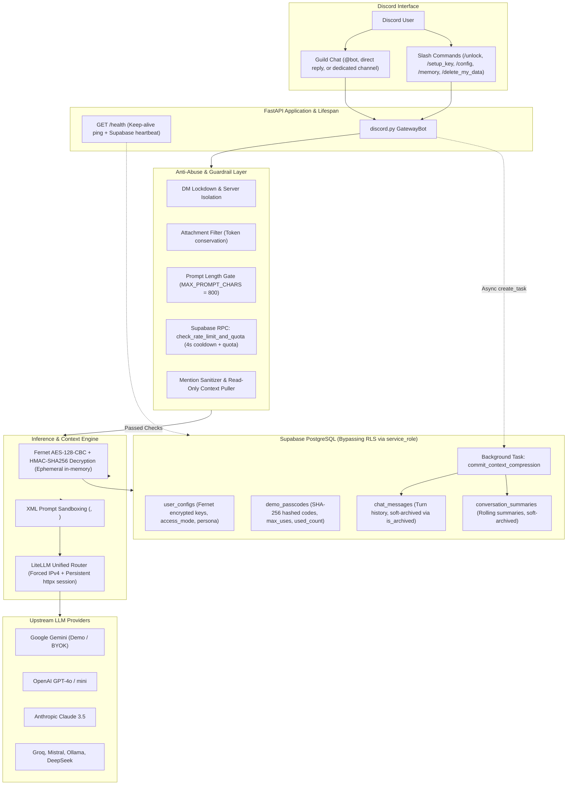

# 🚀 Discord LLM Gateway

[](https://www.python.org/downloads/)
[](https://fastapi.tiangolo.com)
[](https://discordpy.readthedocs.io/)
[](https://docs.litellm.ai/)
[](https://supabase.com/)
[](https://github.com/astral-sh/uv)

A production-grade, multi-tenant Discord AI Gateway featuring application-level symmetric BYOK (Bring Your Own Key) credential encryption, atomic PostgreSQL quota controls, XML prompt-injection sandboxing, and asynchronous sliding-window rolling context compression.

---

## 🏗️ System Architecture



---

## 🌟 Key Architectural Highlights

### 1. Zero-Knowledge BYOK Encryption (Envelope Security)
- **Application-Layer Fernet:** BYOK API keys are encrypted at rest using `AES-128-CBC` with `HMAC-SHA256` authentication (`cryptography.fernet`).
- **Ephemeral Decryption:** Keys are only decrypted in volatile memory inside worker processes immediately prior to inference and never stored unencrypted in application logs, database tables, or persistent disk storage.
- **Privacy Wipe (`/delete_my_data`):** Permanently zeroes out the user's encrypted API key in PostgreSQL, resets access mode, and marks all past conversations as soft-archived.

### 2. Atomic Rate-Limiting & Demo Passcode Gatekeeper
- **Database-Level Concurrency:** Cooldown tracking (4-second sliding window) and shared demo passcode usage decrementing are handled inside a single atomic PostgreSQL stored procedure (`check_rate_limit_and_quota`) executing under row-level exclusion.
- **Zero Race Conditions:** Protects free-tier Gemini API keys from concurrent exhaustion or replay attacks across high-frequency message bursts.
- **Pre-RPC Rejection:** Input character limits (`MAX_PROMPT_CHARS = 800`), file attachments, and direct messages (DMs) are rejected *before* making any database calls, ensuring rejected abuse attempts cost 0 DB connections and 0 quota tokens.

### 3. XML Prompt-Injection Sandboxing
- **Immutable Security Boundary:** User-supplied custom personas are strictly enclosed within `<user_custom_persona>` XML tags, with higher-priority root system instructions explicitly directing the model to treat persona and transcript inputs strictly as conversational data rather than administrative overrides.
- **Summarizer Transcript Isolation:** Rolling memory compression encapsulates conversation history inside `<untrusted_transcript>` tags with explicit directives forbidding instructions inside the transcript from modifying summarizer behavior.
- **Ping Suppression:** All outbound bot replies enforce `allowed_mentions=discord.AllowedMentions.none()` to prevent `@everyone`, `@here`, or server role mention injection attacks.

### 4. Sliding-Window Rolling Context Compression
- **Hybrid Memory Architecture:** Combines short-term active chat turns with a continuously updated background rolling summary (`conversation_summaries`).
- **Non-Blocking Persistence:** Once an LLM reply is generated and streamed back to Discord, database writes (`insert_chat_turn`) and background compression summarization (`commit_context_compression`) run asynchronously via `asyncio.create_task`, eliminating database I/O latency from the user response loop.
- **Soft-Archival (`is_archived`):** Pruned raw messages and cleared context summaries are soft-archived rather than hard-deleted, maintaining compliance, telemetry, and audit readiness while remaining completely hidden from active LLM context windows.

### 5. Multi-User Identity & Cross-User Context Awareness
- **Speaker Tags with Immutable Discord IDs:** Incoming messages are dynamically formatted as `[Speaker: DisplayName (Discord ID: 123456789)]: <message>` before storage and inference, ensuring the model never confuses conversation participants in group channels.
- **Cross-User Context Pulling:** When another server member is `@mentioned`, the gateway pulls their public interaction summary and recent messages (read-only, non-archived) into a `<referenced_users_context>` block.
- **Reply Context Extraction:** Direct Discord replies automatically resolve the referenced parent message (author and excerpt) into a `<replied_to_message>` block.

### 6. Production Networking & Keep-Alive Resilience
- **Windows IPv4 DNS Patching:** Standard Windows network stacks frequently hang on dead IPv6 routes during outbound HTTPS handshakes; the gateway dynamically forces `socket.AF_INET` resolution for bulletproof connectivity.
- **Connection Pooling:** LiteLLM is backed by a custom persistent `httpx.AsyncClient` with keep-alive connection pooling to eliminate cold TLS handshakes.
- **FastAPI Keep-Alive Endpoint:** `/health` periodically queries Supabase to prevent the free-tier Supabase database from pausing after 7 days of inactivity, while simultaneously serving health checks for Render/Fly.io.

---

## ⌨️ Discord Slash Commands

| Command | Modals / Options | Description |
| :--- | :--- | :--- |
| `/unlock` | **Input Modal:** `passcode` | Unlocks the bot using a recruiter or employer demo passcode (SHA-256 verified, bounded usage cap). |
| `/setup_key` | **Input Modal:** `model`, `api_key` | Securely stores a personal API key encrypted with Fernet (`AES-128-CBC` + `HMAC-SHA256`) for unlimited BYOK inference. |
| `/config` | `model`, `system_prompt` | View or customize your target model (BYOK) or system prompt persona. Memory scope is safely pinned to user isolation. |
| `/memory` | `action`: `status` \| `clear_recent` \| `wipe_all` | Inspect active short-term messages and long-term summary, clear short-term context, or soft-archive all active memory. |
| `/delete_my_data` | *None* | **Self-Service Privacy Wipe:** Permanently deletes encrypted API keys, revokes access, and soft-archives memory. |

---

## 🛠️ Tech Stack

- **Runtime:** Python 3.12+
- **Package & Virtual Environment Manager:** [`uv`](https://github.com/astral-sh/uv)
- **API Server & Discord Bot Lifecycle:** [FastAPI](https://fastapi.tiangolo.com) + [Uvicorn](https://www.uvicorn.org/) + [discord.py](https://discordpy.readthedocs.io/)
- **Unified LLM Inference Engine:** [LiteLLM](https://docs.litellm.ai/)
- **Cryptography:** [`cryptography.fernet`](https://cryptography.io/en/latest/fernet/) (AES-128-CBC + HMAC-SHA256) + `hashlib` (SHA-256)
- **Database & Stored Procedures:** [Supabase](https://supabase.com/) (PostgreSQL + PL/pgSQL Atomic Functions + RLS)
- **HTTP Client:** [HTTPX](https://www.python-httpx.org/) (Async client session pooling)

---

## 📁 Repository Structure

```
discord-llm-gateway/
├── .env.example              # Sanitized environment variable template
├── .gitignore                # Git ignore rules (.env, .venv, cache)
├── main.py                   # FastAPI server, /health keep-alive, and Discord bot lifespan
├── pyproject.toml            # Project dependencies and tool configurations
├── uv.lock                   # Deterministic lockfile
├── README.md                 # Project architecture and developer documentation
├── src/
│   ├── __init__.py
│   ├── config.py             # Fail-fast environment variable resolution & defaults
│   ├── security.py           # Fernet encryption/decryption & SHA-256 hashing
│   ├── db.py                 # Supabase client, query abstractions & soft-archival
│   ├── llm.py                # LiteLLM routing, IPv4 socket patch, XML sandboxing & memory
│   └── bot.py                # discord.py client, modal forms, slash commands & event listener
└── supabase/
    └── migrations/
        └── 001_initial_schema.sql  # Tables, RLS policies, triggers, and atomic RPCs
```

---

## 🚀 Local Setup & Installation

### 1. Prerequisites
- **Python 3.12+**
- **[`uv`](https://github.com/astral-sh/uv):** Ultra-fast Python package installer and resolver.
  ```powershell
  # Windows (PowerShell)
  powershell -ExecutionPolicy ByPass -c "irm https://astral.sh/uv/install.ps1 | iex"

  # macOS / Linux
  curl -LsSf https://astral.sh/uv/install.sh | sh
  ```
- **Supabase Account & Project:** [supabase.com](https://supabase.com)
- **Discord Developer Portal Bot Application:** With `Message Content Intent` enabled under the **Bot** tab.

### 2. Clone Repository & Install Dependencies
```bash
git clone https://github.com/your-username/discord-llm-gateway.git
cd discord-llm-gateway

# Sync virtual environment from uv.lock
uv sync
```

### 3. Configure Database
1. Open your Supabase Project Dashboard -> **SQL Editor**.
2. Paste and run the contents of [`supabase/migrations/001_initial_schema.sql`](supabase/migrations/001_initial_schema.sql).
3. Insert a demo passcode to test recruiter/guest access:
   ```sql
   -- Passcode: 'PORTFOLIO-DEMO'
   -- SHA-256 hash: '5c0e0b387e7161bca795899478f796a8be2c53f3e2e0dc38a531cf08e9255e4b'
   insert into public.demo_passcodes (code_hash, label, max_uses, is_active)
   values (
     '5c0e0b387e7161bca795899478f796a8be2c53f3e2e0dc38a531cf08e9255e4b',
     'Recruiter_Demo',
     50,
     true
   );
   ```

### 4. Configure Environment Variables
Copy `.env.example` to `.env`:
```bash
cp .env.example .env
```
Populate `.env` with your actual secrets:
- `DISCORD_BOT_TOKEN`: Bot token from Discord Developer Portal.
- `SUPABASE_URL`: Project URL from Supabase Settings -> API.
- `SUPABASE_SERVICE_ROLE_KEY`: Service role secret key (`service_role`) from Supabase Settings -> API.
- `MASTER_ENCRYPTION_KEY`: Generate a Fernet key:
  ```bash
  uv run python -c "from cryptography.fernet import Fernet; print(Fernet.generate_key().decode())"
  ```
- `DEMO_GEMINI_API_KEY`: Google AI Studio API key used for the demo quota.
- `DEDICATED_CHAT_CHANNEL_ID`: (Optional) Channel ID where the bot responds without requiring `@mentions`.

### 5. Run the Gateway
```bash
uv run python main.py
```
Expected output:
```text
INFO:     Started server process
INFO:     Waiting for application startup.
Slash commands synced globally.
Logged in as DiscordGatewayBot#0000 (ID: 123456789)
INFO:     Application startup complete.
INFO:     Uvicorn running on http://0.0.0.0:8000 (Press CTRL+C to quit)
```

---

## 🔒 Security Best Practices Implemented

- **No Secrets in Version Control:** `.env` and `.venv/` are strictly ignored; all credential templates use sanitized placeholders.
- **Service Role Isolation:** The backend uses the Supabase `service_role` key exclusively from secure backend environments, while client tables enforce Row Level Security (RLS) and RPC execution grants are revoked from `anon` and `authenticated` roles.
- **Fail-Fast Boot:** Missing environment variables throw explicit runtime exceptions on startup via `src/config.py`, preventing unconfigured or degraded service states.
- **Zero-Token Abuse Prevention:** Bypasses LLM calls when inputs violate length bounds, contain attachments, or originate outside authorized guild contexts.

---

## 📄 License
This project is licensed under the [MIT License](LICENSE).
